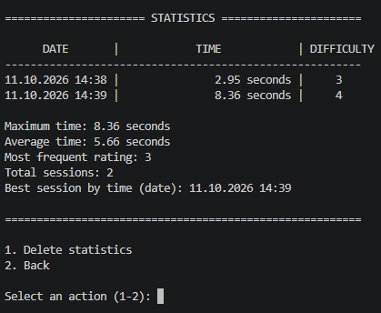

<div align="center">

# Boredom Timer ⏱


</div>

> Boredom timer — counts how long you were bored and saves the statistics.

> [!WARNING]
> **Project status: abandoned (paused indefinitely).**
> The project is functional and can be used as-is.
> The plans below are still relevant — development may resume in the future.

> [!TIP]
> ⚠️ If the `stats.json` file is missing, the app will create it automatically.

## 📖 About the project
Boredom timer is a console application that measures how much time
you were bored and lets you rate the "boredom difficulty" on a scale of 1–5.
The statistics are saved to JSON and available for viewing.

## 🚀 Launch

```bash
python Boredom_Timer.py
```

## 🎮 Usage
1. Run the program.
2. Select 1 to start the timer.
3. Press Enter to start.
4. Be bored.
5. Press Enter to stop.
6. Rate the difficulty (1–5).
7. Session is saved automatically.

## 📸 Screenshots

### Statistics menu



### Stats file (`stats.json`)

```json
[
    {
        "date": "09.10.2026 22:15",
        "time": 5899.42,
        "rate": 3
    },
    {
        "date": "10.10.2026 14:30",
        "time": 1800.00,
        "rate": 2
    }
]
```

## Requirements

- Python 3.10+

## 📁 Project structure

```
Boredom_Timer/
├── Boredom_Timer.py       # main code
├── stats.json             # session database (created automatically)
├── screenshots/
│   └── stats.png          # statistics screenshot
├── .gitignore             # what not to push to Git
└── README.md              # this file
```

## 🛠 Technologies
Python 3.10+

Standard libraries: time, datetime, json, os, collections

## 🗺 Plans

> These plans are still relevant, but development is currently paused.

- [ ] Migrate from JSON to SQLite
- [ ] Add Flask web interface
- [ ] Add AI analysis of sessions
- [ ] Add tests (`pytest`)
- [ ] Split code into modules (`storage.py`, `ui.py`, `stats_view.py`)

## 📄 License

MIT